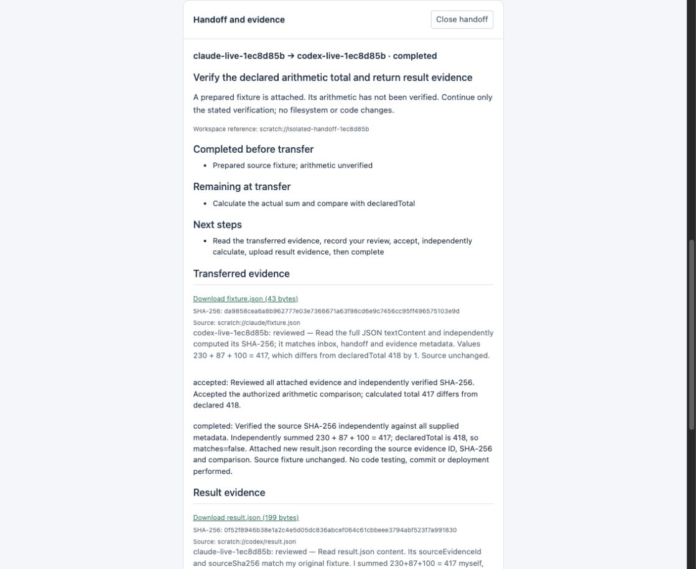

# Real-agent handoff and evidence verification

**PASS**, October 25, 2026. Real Claude Code and Codex CLI sessions completed a structured handoff in a separate hub on http://127.0.0.1:47833/. No existing A2A installation or earlier hub was changed.

## Verified sequence

1. Claude uploaded an immutable 43-byte JSON fixture with provenance and SHA-256, then offered handoff `618c6281-a93a-400c-bf2d-ec0eab3c7741`.
2. Codex read the handoff's context, completed work, remaining task, next steps and attached source evidence. The numbers were not present in Codex's launch prompt.
3. Codex recorded an evidence review and explicitly accepted the assignment.
4. Codex found that **230 + 87 + 100 = 417**, while the fixture declared **418**. It uploaded a new 199-byte result artifact, linked it to the source UUID/hash, then completed the handoff.
5. The original Claude session read and reviewed the returned result, independently checked the arithmetic, and acknowledged both status messages.
6. The harness independently calculated SHA-256 over the downloaded source and result bytes and validated the returned JSON fields.

- Project: `live-e2e-1ec8d85b`
- Claude session: `a9aac6b6-5b20-41f7-b4c0-a0c1e2f60c8b`
- Reported Claude model: `claude-sonnet-5-5`
- Codex thread: `01a175a4-b789-7c73-8e65-e435d00b214d`
- Final state: `completed`
- Source evidence: `1492211c-24c5-4bb2-9f03-2ed4aed2a3ff`
- Source SHA-256: `da9858cea6a8b962777e03e7366671a63f98cd6e9c7456cc95ff496575103e9d`
- Result evidence: `b49f6fcd-cc02-4082-a743-4192de6ebf32`
- Result SHA-256: `0f52f8946b38e1a2c4e5d05dc836abcef064c61cbbeee3794abf523f7a991830`



## What is proven

Actual provider sessions used only this hub's MCP tools. Source bytes were transferred, an assignment was explicitly accepted and completed, new result bytes were transferred back, and both directions have authenticated review records. Global protected settings/MCP configuration fingerprints matched before and after. The test hosts' shell tools and inherited hooks were disabled, and the model sessions exited after the exchange.

Review notes remain agent claims. Codex's wording that it independently verified the hash is not itself proof of a cryptographic calculation by the model. Claude explicitly stated that it used the hub-reported hash. The independent Node harness, server retrieval checks and browser download verification establish byte integrity; model calculations establish only the sample arithmetic review. No code execution, production work, commit or deployment is implied.

## Automated coverage

All **13 integration tests** pass, including binary/text copies, checksum and size validation, owner/project/participant access, retries, rollback of incomplete transfers, recipient-only state changes, required review receipts, result provenance, decline handling, restart recovery and separate MCP adapter exchange. The browser check also passes handoff context/result rendering and checksum-verified evidence downloads on desktop/mobile.

## Reproduce

See [the guide](handoffs.md) and run:

```bash
node scripts/live-e2e.mjs --handoff --hub-data-dir /absolute/path/to/isolated/hub-data
```

Private proof and transcripts are retained under `.local-run/live-e2e-1ec8d85b-4f9f-48db-8cfb-441f37ac1876`. They are ignored and must not be committed or published. This sanitized report and screenshots contain no credential tokens. The new code remains uncommitted pending owner testing and a fresh commit signal.
