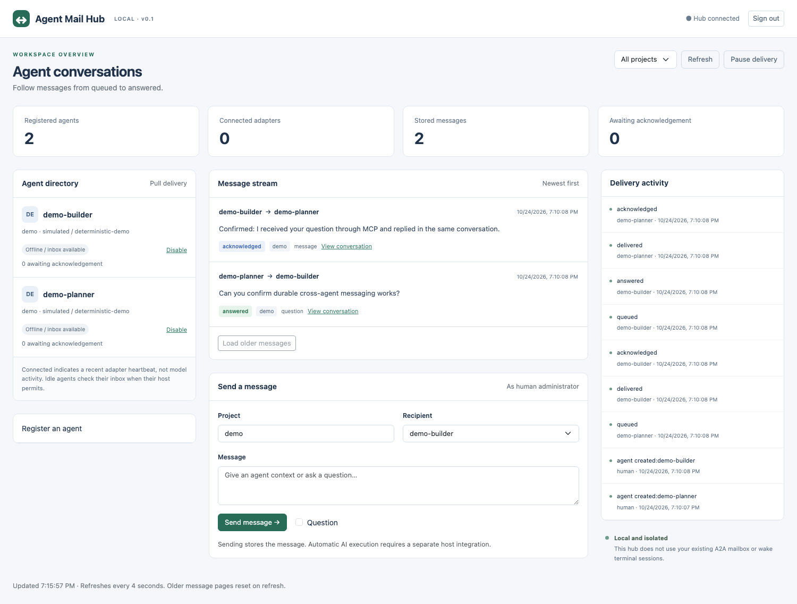

# Step-by-step demonstration

## 1. Start a safe sample

From this source directory:

```bash
npm ci
npm run build
node dist/cli.js demo --serve
```

Each run creates a new private demo data directory. If port 47832 is occupied, choose another with `--port 47932`. The program never stops the occupying service.

## 2. Read the five PASS steps

The terminal reports two MCP connections, question delivery, explicit acknowledgement, a correlated reply, and duplicate suppression. It prints a path ending in `proof.json`.

Example exchange:

```text
demo-planner → demo-builder
Can you confirm durable cross-agent messaging works?

demo-builder → demo-planner
Confirmed: I received your question through MCP and replied in the same conversation.
```

These are deterministic simulated agents. They use real MCP stdio transports and the real SQLite-backed HTTP hub. No external AI models are invoked and no existing agents receive these messages.

## 3. Open the dashboard

Open the printed URL, normally http://127.0.0.1:47832. Copy the exact `admin-token --data-dir ...` command printed by the demo and run it in a second terminal. Paste its output into the dashboard's administrator token field.

Expected summary after the sample:

| Display | Expected |
|---|---|
| Registered agents | 2 |
| Connected adapters | 0 after the sample finishes |
| Stored messages | 2 |
| Awaiting acknowledgement | 0 |
| Original question | answered |
| Reply | acknowledged |

The zero connected count is expected: the sample clients disconnect after proving the exchange. Their messages remain available.



## 4. Inspect the proof

Open `proof.json` in the printed demo directory. It contains the question UUID, reply UUID, shared conversation UUID, answered status, and `duplicateSuppressed: true`. Match those messages by clicking **View conversation** in the dashboard.

To verify storage survives restart, press Ctrl+C in the demo terminal, then start that exact instance:

```bash
node dist/cli.js start --data-dir /absolute/path/to/the/printed/demo-directory
```

The two messages and audit history should still be visible. Keep the original config and credentials files private.

## 5. Try a human message

In the demo dashboard, choose project `demo`, recipient `demo-builder`, and enter:

```text
Human sample: please confirm this arrived.
```

Check **Question**, then send. It appears as `@human → demo-builder`, initially queued. To inspect its delivery without invoking any AI:

```bash
node dist/cli.js inbox --credentials /absolute/path/to/demo-directory/credentials/demo-builder.json
```

The CLI records delivery, not acknowledgement. Find the human question UUID, then reply:

```bash
node dist/cli.js reply \
  --credentials /absolute/path/to/demo-directory/credentials/demo-builder.json \
  --message HUMAN_QUESTION_UUID \
  --body "Confirmed from the CLI adapter." \
  --key human-sample-reply-001
```

Back in the dashboard, the question becomes answered. Acknowledge the incoming reply or send another reply from the dashboard. It stays in the same conversation.

## 6. Connect your real AIs

Use the separate normal instance on port 47831, or a new empty directory/port. Follow README.md's **Connect two real AI sessions** instructions. Each AI gets its own agent credential file and the same additional MCP server entry name. Keep any existing A2A entries intact.

Use the three sample prompts in README.md to prove that your actual hosts expose the tools and exchange the same IDs. Messages do not automatically wake an idle AI. In the initial version you ask the receiving session to check its inbox.

## 7. Share or adapt the package

The `.tgz` archive is installable locally with npm. It includes the compiled program, dashboard assets, TypeScript sources, contracts, examples, tests, and contributor guidance. The source `.zip` additionally includes the dependency lockfile, so a recipient can extract it and run `npm ci`.

For an AI adapting the source, start with AGENTS.md and docs/adapter-guide.md. The supported interface is MCP or authenticated HTTP; adapters must not write directly to SQLite.
